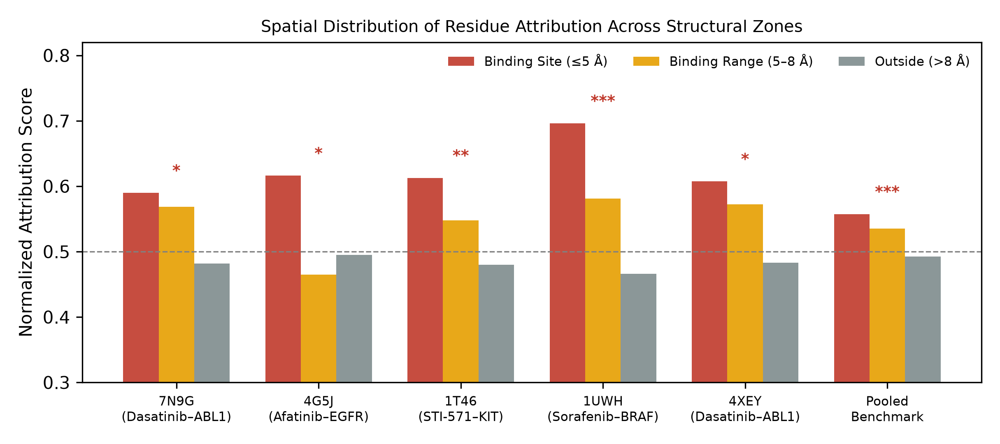
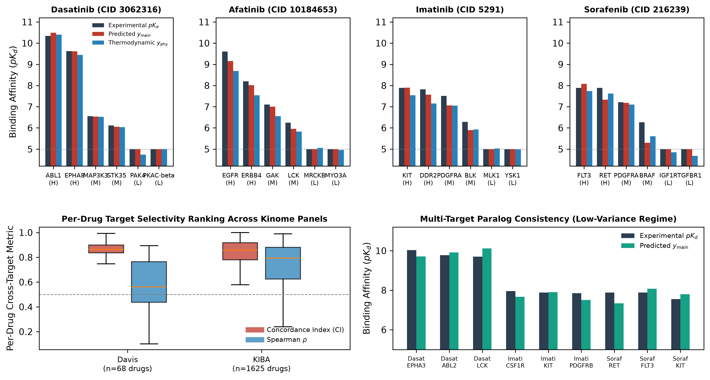

# GibbsDTA: A Thermodynamics-Inspired Deep Learning Framework for Drug-Target Affinity Prediction

[](https://pytorch.org/)
[](https://www.python.org/)
[](https://opensource.org/licenses/MIT)

Official PyTorch implementation of **GibbsDTA** (*"GibbsDTA: a thermodynamics-inspired deep learning framework for generalizable and structurally interpretable drug-target affinity prediction"*).

---

## 1. Overview

**GibbsDTA** is a multimodal, structure-agnostic deep learning framework that regularizes continuous drug–target binding affinity (DTA) prediction via a thermodynamics-inspired dual-branch readout—without requiring experimental 3D protein–ligand co-crystal structures during training or inference:

- **Frozen Foundation Token Encoders**: Extracts unpooled atomic token embeddings from **Uni-Mol** (`512`-d) in canonical RDKit heavy-atom + hydrogen order and evolutionary residue token embeddings from **ESM-2** (`esm2_t12_35M_UR50D`, `480`-d).
- **Bilateral Multi-Head Cross-Attention**: Models reciprocal Drug-to-Target (`D2T`, ligand atoms querying protein residues) and Target-to-Drug (`T2D`, protein residues querying ligand atoms) interactions with residual connections prior to masked adaptive max pooling.
- **Thermodynamics-Inspired Dual-Branch Readout**: Routes the joint complex representation $\boldsymbol{v}_{\mathrm{complex}} \in \mathbb{R}^{512}$ through a primary affinity regression branch ($y_{\mathrm{main}}$) and an auxiliary Gibbs free-energy decomposition branch ($y_{\mathrm{phy}} = H - T \cdot S$), jointly supervised via:
  $$\mathcal{L} = \mathcal{L}_{\mathrm{MSE}}(y_{\mathrm{main}}, y) + \lambda_{\mathrm{phy}} \, \mathcal{L}_{\mathrm{MSE}}(H - T \cdot S, y)$$
- **Zero-Supervision Structural & Thermodynamic Interpretability**: Uses 64-step token-level Integrated Gradients (`IG`) over aligned token embeddings $(\boldsymbol{E}_L, \boldsymbol{E}_P)$ to recover 3D catalytic binding pockets ($\le 5\text{ \AA}$), resolve ligand-specific clinical resistance mutations, decouple polar warheads from flexible solvent-exposed tails, and profile kinome-wide target selectivity.

---

## 2. Benchmark Results (5-Fold Cross-Validation)

All checkpoints and fold-level test predictions are provided in [`results/5fold/`](results/5fold/). Values report **mean ± SD** across the 5 stratified cross-validation folds:

| Dataset | Setting | Split Protocol | MSE ↓ | RMSE ↓ | CI ↑ | $r_m^2$ ↑ | AUPR ↑ |
| :--- | :---: | :--- | :---: | :---: | :---: | :---: | :---: |
| **Davis** | `Setting 1` | Warm-Start (Random Pair Split) | **0.1494 ± 0.0065** | **0.3865 ± 0.0084** | **0.9154 ± 0.0038** | **0.7622 ± 0.0162** | **0.8180 ± 0.0168** |
| **Davis** | `Setting 2` | Cold-Start (Unseen Drug) | 0.5402 ± 0.1152 | 0.7312 ± 0.0836 | 0.7269 ± 0.0177 | 0.1990 ± 0.0574 | 0.3082 ± 0.1410 |
| **Davis** | `Setting 3` | Cold-Start (Unseen Target) | 0.2568 ± 0.0406 | 0.5054 ± 0.0409 | 0.8734 ± 0.0163 | 0.5985 ± 0.0308 | 0.6923 ± 0.0454 |
| **Davis** | `Setting 4` | Cold-Start (Both Unseen) | 0.5826 ± 0.1166 | 0.7600 ± 0.0793 | 0.6850 ± 0.0552 | 0.1358 ± 0.0694 | 0.2618 ± 0.1428 |
| **KIBA** | `Setting 1` | Warm-Start (Random Pair Split) | **0.1345 ± 0.0027** | **0.3667 ± 0.0037** | **0.8970 ± 0.0004** | **0.8030 ± 0.0118** | **0.8479 ± 0.0024** |
| **KIBA** | `Setting 2` | Cold-Start (Unseen Drug) | 0.3793 ± 0.0371 | 0.6153 ± 0.0298 | 0.7769 ± 0.0059 | 0.4492 ± 0.0346 | 0.6486 ± 0.0198 |
| **KIBA** | `Setting 3` | Cold-Start (Unseen Target) | 0.2964 ± 0.0398 | 0.5434 ± 0.0357 | 0.7872 ± 0.0235 | 0.5775 ± 0.0270 | 0.7092 ± 0.0058 |
| **KIBA** | `Setting 4` | Cold-Start (Both Unseen) | 0.5223 ± 0.0959 | 0.7205 ± 0.0632 | 0.6924 ± 0.0173 | 0.2875 ± 0.0364 | 0.5377 ± 0.0336 |

---

## 3. Structural & Thermodynamic Interpretability (`E0`–`E5`)

Without any 3D structural supervision during training, token-level Integrated Gradients (`|IG(y_main)|`, `|IG(y_phy)|`, `IG(H)`, and `IG(S)`) evaluated across **114 experimental RCSB PDB kinase–inhibitor co-crystal complexes** recover physical binding pockets and thermodynamic driving forces:

### 3.1 3D Catalytic Pocket Spatial Enrichment (`E1`)

Residues are partitioned by heavy-atom minimum distance $d_{\min}$ to the co-crystallized ligand into **Binding Site** ($d_{\min} \le 5\text{ \AA}$), **Binding Range** ($5 < d_{\min} \le 8\text{ \AA}$), and **Outside** ($d_{\min} > 8\text{ \AA}$):

| PDB ID | Drug | Target | Binding Site ($\le 5\text{ \AA}$) | Binding Range ($5\text{--}8\text{ \AA}$) | Outside ($> 8\text{ \AA}$) | Site vs. Outside | Pocket AUROC | EF@5% |
| :---: | :--- | :--- | :---: | :---: | :---: | :---: | :---: | :---: |
| `1UWH` | Sorafenib | BRAF | **0.696 ± 0.222** | 0.581 ± 0.216 | 0.466 ± 0.293 | `***` | **0.716** | **4.686** |
| `4G5J` | Afatinib | EGFR | **0.616 ± 0.273** | 0.465 ± 0.266 | 0.495 ± 0.290 | `*` | **0.624** | **2.558** |
| `1T46` | Imatinib (STI-571) | KIT | **0.613 ± 0.222** | 0.548 ± 0.257 | 0.480 ± 0.297 | `**` | **0.623** | **1.366** |
| `4XEY` | Dasatinib | ABL1 | **0.607 ± 0.251** | 0.572 ± 0.284 | 0.483 ± 0.289 | `*` | **0.614** | **3.941** |
| `7N9G` | Dasatinib | ABL1 | **0.590 ± 0.266** | 0.568 ± 0.253 | 0.482 ± 0.293 | `*` | **0.597** | **3.472** |
| **Pooled (114 PDBs)** | All Complexes | All Kinases | **0.557 ± 0.290** | **0.536 ± 0.283** | **0.493 ± 0.288** | `***` ($p < 10^{-8}$) | **0.557** | **1.988** |

<p align="center">
  
  
</p>

### 3.2 Dual-Branch Thermodynamic Equilibrium & Selectivity (`E3`–`E5`)

- **Branch Convergence & Thermodynamic Opposition (`E3`–`E4`)**: The primary readout $y_{\mathrm{main}}$ and thermodynamic readout $y_{\mathrm{phy}} = H - T \cdot S$ exhibit strong token-level attribution concordance (median residue $\rho(|IG_{\mathrm{main}}|, |IG_{\mathrm{phy}}|) = 0.790$ in warm-start and $0.885$ in cold-target settings), while signed attributions $\mathrm{IG}(H)$ and $\mathrm{IG}(S)$ are anti-correlated (median atom $\rho = -0.517$ to $-0.652$), reflecting enthalpy–entropy compensation between rigid hinge-binding warheads and flexible solubilizing tails.
- **Kinome-Wide Per-Drug Selectivity (`E5`)**: Across selective inhibitors ($\ge 10$ profiled targets, affinity range $\ge 1.5$ log units), GibbsDTA achieves a median per-drug Concordance Index of **0.863** on Davis ($100\%$ of drugs with $\mathrm{CI} > 0.7$) and **0.859** on KIBA (median Spearman $\rho = 0.793$).

---

## 4. Repository Structure

```text
├── model.py                         # GibbsDTA architecture (projection, bilateral MHA, dual-branch readout)
├── dataset.py                       # Dataset loader and dynamic sequence padding collate function
├── train.py                         # Single-epoch dual-branch training loop (L_main + lambda_phy * L_phy)
├── test.py                          # Evaluation metrics (MSE, RMSE, CI, r_m^2, AUPR)
├── run.py                           # Main training & 5-fold cross-validation entry point
├── download_models.py               # Helper script to pre-download HuggingFace backbones
├── extract_unimol.py                # Offline Uni-Mol atomic token embedding extraction (512-d)
├── extract_features.py              # Offline ESM-2 protein residue token embedding extraction (480-d)
├── generate_cv_folds.py             # 5-fold cross-validation split generator
├── generate_cold_folds.py           # Cold-start split generator (Unseen drug / target / both unseen)
├── generate_stratified_folds.py     # Stratified clustering split generator
├── run_ubuntu.sh                    # 5-fold cross-validation launcher script (Linux / macOS)
├── run_windows.bat                  # 5-fold cross-validation launcher script (Windows)
├── run_all_experiments.sh           # Batch script for Warm-start, Cold-start, and Ablation experiments
├── data/                            # Benchmark datasets (Davis and KIBA)
│   ├── davis/                       # Davis.csv, ligands_can.txt, proteins.txt, Y, mappings, and folds/
│   └── kiba/                        # KIBA.csv, ligands_can.txt, proteins.txt, Y, mappings, and folds/
├── results/                         # 5-fold CV model checkpoints (.pth), test predictions, and metrics
│   ├── 5fold/                       # Warm-start (setting_1) and Cold-start (setting_2..4) results
│   │   ├── result_5fold_davis/      # Davis setting_1..4 train checkpoints & test predictions
│   │   └── result_5fold_kiba/       # KIBA setting_1..4 train checkpoints & test predictions
│   └── extract_metrics.py           # Utility script to aggregate 5-fold mean ± SD metrics
├── interpret/                       # Post-hoc structural & thermodynamic interpretability suite (E0-E5)
│   ├── README.md                    # Detailed documentation for the interpretability pipeline
│   ├── config.py                    # Central configuration and path resolution
│   ├── common.py                    # Shared model loading, IG attribution, and geometry utilities
│   ├── case_infer.py                # Single-complex inference and token attribution export
│   ├── e0_unimol_check.py           # Verification gate for Uni-Mol atomic token alignment (99.95% acc)
│   ├── e0_infer.py                  # Full test-set dual-branch inference verification gate
│   ├── e1_struct_labels.py          # 3D RCSB PDB co-crystal pocket/contact ground-truth builder
│   ├── e1_pocket_stats.py           # Spatial zone enrichment (<=5 Å, 5-8 Å, >8 Å), AUROC, and EF@5%
│   ├── e2_figures.py                # Per-complex 3D PyMOL / 2D RDKit structural attribution maps
│   ├── e3_thermo.py                 # Thermodynamic branch equilibrium audit & descriptor correlations
│   ├── e4_attribution.py            # 64-step Integrated Gradients on H, S, y_main, and y_phy
│   ├── e5_selectivity.py            # Kinome-wide per-drug cross-target selectivity profiling
│   ├── make_paper_figures.py        # Publication composite figure generator (Figs. 2-6)
│   ├── generate_architecture_fig.py # Architecture diagram generator (Fig. 1)
│   ├── run_all.sh                   # End-to-end interpretability pipeline runner
│   ├── cases/                       # Curated PDB co-crystal metadata (cases.yaml, candidates.csv)
│   └── structures/                  # Experimental RCSB PDB co-crystal coordinates (114 complexes)
└── interpret_outputs/               # Precomputed interpretability tables, IG scores, and figures (e0-e5)
    ├── e0/                          # Sanity report, token map, and dual-branch test predictions
    ├── e1/                          # 3D pocket enrichment stats, atom/residue scores, and zone plots
    ├── e2/                          # Per-complex 2D ligand SVG/PNG maps and 3D PyMOL render scripts
    ├── e3/                          # Enthalpy-entropy compensation & physicochemical heatmaps
    ├── e4/                          # 64-step Integrated Gradients completeness & branch agreement
    └── e5/                          # Cross-target selectivity profiles and summary tables
```

---

## 5. Environment & Installation

```bash
# 1. Create and activate conda environment
conda create -n gibbsdta python=3.10 -y
conda activate gibbsdta

# 2. Install PyTorch (adjust CUDA version as needed for your hardware)
pip install torch torchvision torchaudio

# 3. Install core dependencies and interpretability requirements
pip install transformers unimol_tools rdkit biopython scipy pandas numpy scikit-learn matplotlib seaborn pyyaml tqdm requests
```

*(Optional)* For 3D ray-traced protein rendering in `interpret/e2_figures.py`:
```bash
conda install -c conda-forge pymol-open-source
```

---

## 6. Usage Guide

### 6.1 Offline Token Feature Extraction

To train from scratch, first extract frozen token-level representations for ligands (**Uni-Mol**, `512`-d) and proteins (**ESM-2**, `480`-d):

```bash
# 1. Extract ESM-2 residue token embeddings -> data/{davis,kiba}/features/proteins/*.pt
python extract_features.py

# 2. Extract Uni-Mol atomic token embeddings -> data/{davis,kiba}/features/ligands_unimol/*.pt
python extract_unimol.py
```

### 6.2 Training & 5-Fold Cross-Validation

#### Warm-Start 5-Fold Cross-Validation (`--setting 1`)
```bash
# Davis (150 epochs, batch size 64, lr 1e-4, Uni-Mol encoder)
bash run_ubuntu.sh davis 150 64 0.0001 unimol --setting 1 --use_stratified

# KIBA (150 epochs, batch size 64, lr 1e-4, Uni-Mol encoder)
bash run_ubuntu.sh kiba 150 64 0.0001 unimol --setting 1 --use_stratified
```

#### Cold-Start Generalization (`--setting 2, 3, 4`)
- `--setting 2`: **Unseen Drug** (cold ligand split)
- `--setting 3`: **Unseen Target** (cold protein split)
- `--setting 4`: **Both Unseen** (strict dual cold-start split)

```bash
bash run_ubuntu.sh davis 150 64 0.0001 unimol --setting 2 --use_stratified
bash run_ubuntu.sh davis 150 64 0.0001 unimol --setting 3 --use_stratified
bash run_ubuntu.sh davis 150 64 0.0001 unimol --setting 4 --use_stratified
```

#### Single-Fold Direct Execution via `run.py`
```bash
python run.py \
  --data_path data \
  --dataset davis \
  --epochs 150 \
  --batch_size 64 \
  --lr 0.0001 \
  --lambda_phy 0.1 \
  --temperature 1.0 \
  --val_fold 0 \
  --smi_encoder unimol \
  --setting 1 \
  --use_stratified
```

#### Ablation Studies
```bash
# w/o Thermodynamic Regularization (lambda_phy = 0.0)
bash run_ubuntu.sh davis 150 64 0.0001 unimol --lambda_phy 0.0 --use_stratified

# w/o Bilateral Cross-Attention
bash run_ubuntu.sh davis 150 64 0.0001 unimol --no_cross_attention --use_stratified

# w/o Both (Concat + MLP baseline)
bash run_ubuntu.sh davis 150 64 0.0001 unimol --lambda_phy 0.0 --no_cross_attention --use_stratified
```

### 6.3 Post-Hoc Interpretability & Manuscript Figure Reproduction

All interpretability experiments (`E0`–`E5`) and publication figures can be reproduced via the [`interpret/`](interpret/) suite (see [`interpret/README.md`](interpret/README.md) for details):

```bash
# Run the complete E0-E5 interpretability pipeline
bash interpret/run_all.sh

# Or run individual analysis stages
bash interpret/run_all.sh --steps e0,e1,e3,e4,e5

# Regenerate manuscript composite figures (Figs. 1-6)
python interpret/generate_architecture_fig.py
python interpret/make_paper_figures.py
```

---

## 7. License

This project is released under the MIT License.
